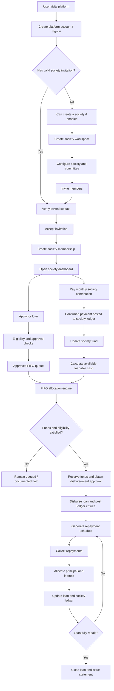
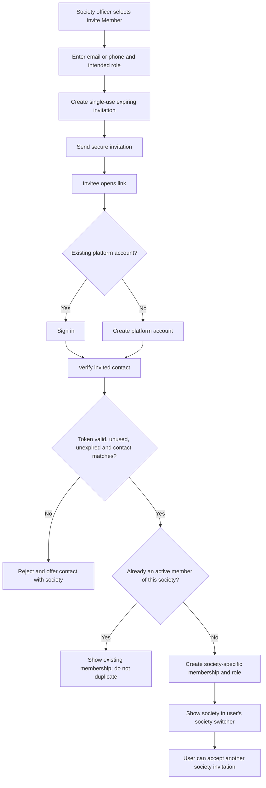
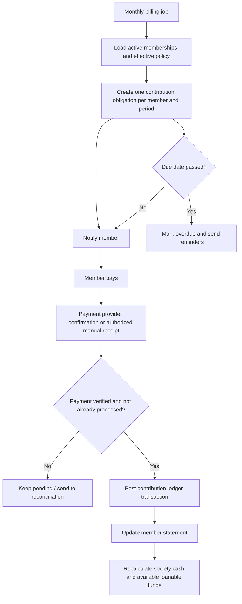
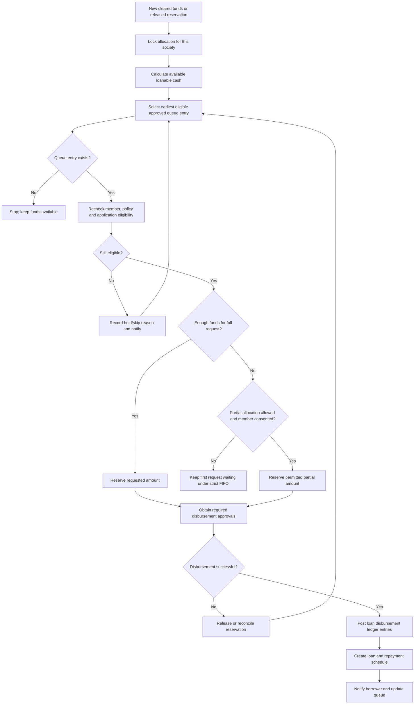
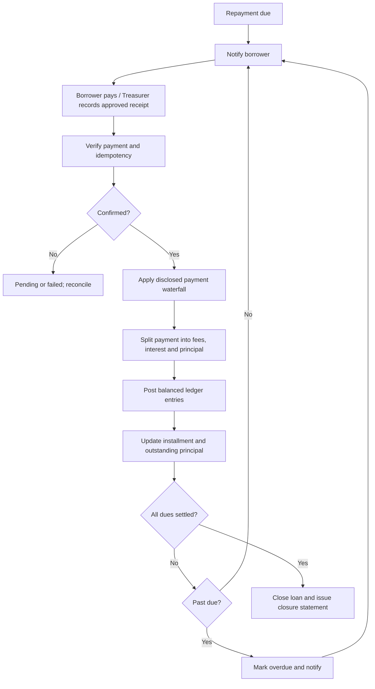

# Society Savings & Loan Management Platform
## Product Requirements Document (PRD)

**Document status:** Draft v1.0  
**Date:** 10 November 2026  
**Product type:** Multi-tenant SaaS platform for society administration, member contributions, pooled funds, and member lending

---

## 1. Product overview

The product is a multi-tenant platform through which multiple independent societies can create and manage their own digital accounts. Each society can invite members, assign committee roles, collect recurring monthly contributions, maintain a transparent society fund, and lend money from that fund to eligible members.

A person may belong to more than one society. They should have one platform identity and switch between their society memberships. Their role, contribution obligations, loan eligibility, balances, and records are scoped independently to each society.

The platform operator may charge a recurring SaaS/platform fee. Separately, each society may collect recurring member contributions into its own fund. These are two different financial flows and must never be mixed.

### 1.1 Product vision

Make community-based savings and lending easier to administer, auditable, fair, and transparent, while preserving each society's autonomy over its membership, contribution rules, lending policy, interest rate, and governance.

### 1.2 Goals

- Allow multiple societies to onboard and operate independently.
- Allow a society to configure its committee structure and invite members.
- Enforce invitation-only registration for society membership.
- Support one user belonging to multiple societies.
- Collect and track monthly platform fees and society contributions as separate obligations.
- Maintain a society-level fund balance using a double-entry or equivalently auditable ledger.
- Let societies define loan rules and a configurable interest rate.
- Process loan requests through a visible FIFO queue, with clearly defined eligibility and approval rules.
- Track loan disbursement, principal, interest, repayments, overdue amounts, and closure.
- Give authorized users clear financial reports and an audit trail.

### 1.3 Non-goals for the first release

- Lending money from the platform operator's own balance sheet.
- Combining the funds of different societies.
- Public self-registration into a society without an invitation.
- Automated credit scoring using external bureau data.
- Complex investment products or yield generation on idle society funds.
- Cross-society loans or transfers.
- A public marketplace where unrelated societies fund one another's loans.

---

## 2. Important product and financial distinction

The initial description says members pay a fixed amount every month “to us” and that the society's total amount is maintained for lending. This needs to be represented as two separate configurable payment types:

### A. Platform subscription fee

- Paid by a society, its members, or another configured payer to the platform operator.
- This is SaaS revenue.
- It is not part of the society's loanable fund.
- The payer model must be configurable: society-level subscription, per-active-member subscription, or another approved pricing plan.
- If the business decision is that every member pays the platform directly, create a separate platform-fee obligation for every member.

### B. Society contribution

- Paid by a member to their society.
- Credited to that society's fund only after payment is confirmed.
- Used for society-approved purposes, including member loans.
- Must be recorded in the society's ledger and never treated as platform revenue.

**Non-negotiable accounting rule:** Platform fees and society contributions must use separate transaction categories, accounts, reports, and reconciliation paths. The platform must not show platform fees as society savings or loanable funds.

The society's displayed available fund should be calculated from its ledger, not from a manually editable total.

---

## 3. Users, roles, and permissions

Roles are assigned per society membership. A user can be President in Society A and an ordinary Member in Society B.

### 3.1 Platform-level roles

| Role | Responsibilities |
|---|---|
| Platform Super Admin | Operates the SaaS platform, manages platform configuration, support, subscription plans, and platform-level controls. |
| Platform Finance/Operations | Reconciles platform subscription payments, manages platform invoices and refunds where permitted. |
| Platform Support | Helps users with account and technical issues. Access to society financial data should be restricted and audited. |

Platform staff must not be able to silently change a society's fund, approve a society loan, or alter its lending policy.

### 3.2 Society-level roles

| Role | Typical permissions |
|---|---|
| President | Society oversight; view dashboards; perform or approve actions assigned by the society's governance policy. |
| Vice President | Delegated oversight and approval responsibilities. |
| Secretary | Member records, invitations, notices, meeting records, and administrative workflows. |
| Treasurer | Contributions, reconciliation, ledger, fund reports, repayment tracking, and financial operations. |
| Member | View own membership, contributions, loan applications, repayments, and permitted society-level transparency information. |

The society may configure approval thresholds and permitted actions, but the system must enforce separation of duties for sensitive operations. For example, the person entering a disbursement should not be the only person approving it if the society's policy requires dual approval.

### 3.3 Permission model

- Permissions are attached to a role within a particular society, not globally to the user's platform account.
- A user may hold multiple roles only if the society explicitly permits it.
- Role changes must record who made the change, when, the old role, and the new role.
- The society should be able to configure which roles can invite members, approve loans, approve disbursements, record cash payments, reconcile payments, waive penalties, and view member-level financial details.
- High-risk actions should support maker-checker approval.
- Members must never see another society's data simply because they belong to the same platform.

---

## 4. Main product modules

1. Platform account and authentication
2. Society onboarding and configuration
3. Committee and role management
4. Invitation and membership management
5. Multi-society user dashboard
6. Monthly contribution management
7. Society fund and financial ledger
8. Loan policy configuration
9. Loan application and eligibility
10. FIFO loan queue and allocation
11. Loan approval and disbursement
12. Repayment and interest management
13. Notifications and reminders
14. Reports, statements, and audit logs
15. Platform subscription and billing
16. Security, compliance, and administration

---

## 5. End-to-end product workflow

### 5.1 Platform onboarding

1. A person visits the platform.
2. The person creates a platform account using the supported authentication method.
3. The platform verifies their email address or phone number.
4. The user lands on a dashboard.
5. If the user has no society invitation or existing membership, they cannot join a society by selecting it from a public directory.
6. The user can create a society if the platform allows society creation, or accept an invitation sent by an existing society.
7. A user who belongs to multiple societies sees all active memberships in one account.

**Important:** Creating a platform login and becoming a member of a society are separate actions. A person may have a platform account without belonging to any society.

### 5.2 Society creation and setup

1. An authorized user selects **Create Society**.
2. They enter society details:
   - Legal/registered name
   - Display name
   - Registration number, where applicable
   - Address and jurisdiction
   - Contact details
   - Society type
   - Currency
   - Time zone
   - Financial year start
3. The creator verifies the required contact information and accepts the platform terms.
4. The platform creates a tenant/society workspace with a unique society ID.
5. The creator becomes the initial society administrator or the configured founding role.
6. The society sets its committee structure and assigns President, Vice President, Secretary, and Treasurer.
7. The society configures contribution rules, loan policy, interest rate, approval workflow, and notification preferences.
8. The society completes any required verification or compliance checks before financial features are enabled.

A society must not be allowed to lend funds until its required setup, authorized signatories, and applicable verification checks are complete.

### 5.3 Committee setup

- The creator can assign existing invited users or invite new people to committee positions.
- The society should support one or more office holders per role if its constitution permits.
- Role assignment has an effective date and, optionally, an end date.
- Committee members are also society members if the society's rules require it.
- Committee members follow the same contribution rules as other members unless the society explicitly configures a lawful exemption.
- Changing the Treasurer must not change the underlying ledger or erase previous financial responsibility history.

### 5.4 Invitation-only member registration

**Invitation sources:** President, Vice President, Secretary, Treasurer, or another role authorized by the society.

1. An authorized officer opens **Invite Member**.
2. They enter the invitee's email address or phone number and optionally name/member reference.
3. They select the intended society role (normally Member) and any permitted initial settings.
4. The platform generates a unique, random, single-use invitation token.
5. The invitation is linked to:
   - Society ID
   - Invited contact
   - Intended role
   - Inviter user ID
   - Expiry time
   - Invitation status
6. The invitee receives a secure invitation link or code.
7. The invitee opens the link and verifies control of the invited email/phone.
8. If the invitee already has a platform account, they authenticate and accept the invitation.
9. If the invitee does not have an account, they create one and verify the contact method.
10. The platform checks that the token is valid, unexpired, unused, and intended for the verified contact.
11. The platform creates a society membership and attaches the society-specific role.
12. The invitation is marked accepted and cannot be reused.
13. The member receives access to the society workspace.

**Security requirements:**
- No public endpoint may create an active society membership without a valid invitation or an explicitly approved administrative process.
- Invitation tokens must be unguessable, single-use, revocable, and time-limited.
- The invitee's verified contact must match the invitation destination, unless an authorized officer updates and reissues it.
- The system must prevent duplicate active memberships for the same user and society.
- The society can revoke or resend pending invitations.
- Invitation acceptance, rejection, expiry, and revocation must be auditable.

### 5.5 One user, multiple societies

A platform user has one global identity and a separate membership record for each society.

Example:

- User A: President in Society 1
- User A: Member in Society 2
- User A: Treasurer in Society 3

Each membership has its own:
- Society ID
- Member number
- Role and permissions
- Join date and status
- Contribution schedule and payment history
- Loan eligibility and loan history
- Society-specific notifications and preferences

The dashboard should show a society switcher. The user must explicitly select a society before performing a society-specific financial action. Every backend request must verify the user's membership and permission in the selected society.

Leaving or being removed from one society must not delete the user's platform account or affect their memberships in other societies. Outstanding loans and repayment obligations must remain visible and enforceable according to the applicable agreement and law.

### 5.6 Monthly contribution workflow

Each society configures:
- Contribution amount
- Billing frequency (initial release: monthly)
- Due day or due date rule
- Grace period
- Late fee or penalty policy, if permitted
- Whether contributions are mandatory
- Whether committee members follow the same rule
- Whether members can make advance payments
- Accepted payment methods
- Whether cash/manual payments are allowed and what evidence is required

Workflow:

1. At the start of a billing cycle, the system generates a contribution obligation for each eligible active member.
2. The member receives an invoice/notice showing society, period, amount, due date, and payment instructions.
3. The member pays using an enabled payment method.
4. The payment provider sends a signed confirmation/webhook, or an authorized Treasurer records a manual payment with receipt/reference details.
5. The platform verifies the payment and prevents duplicate processing using an idempotency key/provider transaction ID.
6. A confirmed society contribution is posted to the correct society ledger.
7. The member's contribution status changes to Paid.
8. The society fund balance and member statement update.
9. If unpaid, the obligation becomes Due, then Overdue according to the configured grace period.
10. Reminders are sent according to the society's notification settings.
11. Any refund, reversal, or correction is recorded as a new linked ledger entry; the original transaction is not silently deleted.

Contribution statuses:
- Scheduled
- Due
- Pending
- Paid
- Partially Paid (only if enabled)
- Overdue
- Waived
- Failed
- Refunded/Reversed

> waiver->In simple words, the member's pending contribution is forgiven by the society.

A waiver requires a reason and the configured approval. Waiving a contribution does not create money in the society fund.

### 5.7 Society fund and ledger

The society fund is the total of eligible posted ledger entries, not a manually editable number.

The dashboard should distinguish:
- **Total cash/bank balance:** funds held by the society.
- **Reserved for approved loans:** funds committed to approved but not yet fully disbursed loans.
- **Outstanding principal:** principal currently owed by borrowers; this is an asset/receivable, not cash available for a new disbursement.
- **Available loanable cash:** cleared cash/bank funds minus reserves and other restricted or payable amounts.
- **Overdue receivables:** loan amounts past due.
- **Interest collected:** separately reported income.
- **Platform fees:** excluded from society fund.

At minimum, ledger entries should include:
- Society contribution received
- Loan disbursement
- Principal repayment
- Interest repayment
- Late fee/penalty, if enabled
- Bank/payment processing charge
- Refund/reversal
- Authorized adjustment
- Transfer between society-owned accounts, if supported

Each transaction must include society ID, amount, currency, transaction type, effective date, created date, actor, payment reference, linked member/loan where applicable, approval state, and audit metadata.

**Accounting controls:**
- Use integer minor currency units (for example, paise) rather than floating-point arithmetic.
- Posted ledger entries are immutable. Corrections use reversing and replacement entries.
- The fund balance is derived from posted ledger entries and reconciled against bank/payment-provider records.
- A loan disbursement must reduce cash and create a loan receivable; it must not be treated as an expense that makes the principal disappear from accounting.
- Principal repayment reduces the receivable and increases cash.
- Interest repayment is recorded separately from principal.
- Do not count outstanding principal as available cash for new loans.
- Manual adjustments require a reason and approval.

### 5.8 Loan policy configuration

Each society can configure its own policy, subject to platform rules and applicable law:

- Annual or monthly interest rate
- Whether the rate is flat or reducing-balance
- Interest calculation convention (for example, daily accrual or monthly calculation)
- Loan minimum and maximum
- Maximum outstanding loans per member
- Minimum membership tenure
- Minimum contribution history or paid-month threshold
- Treatment of overdue contributions
- Loan purpose requirement
- Repayment frequency
- Loan tenure
- Installment calculation method
- Grace period
- Late payment/penalty rules
- Early repayment rules
- Whether partial disbursement is permitted
- Whether guarantors or collateral are required
- Approval quorum and authorized approvers
- FIFO queue policy and exception policy

**Interest rate changes:** A new rate applies only to loans created after its effective date unless a valid agreement and applicable law expressly permit otherwise. Existing loans retain a stored snapshot of the agreed rate and calculation method.

The system must clearly label whether the interest rate is monthly or annual and whether it is flat or reducing-balance. Never display an ambiguous value such as “2% interest” without the period and method.

### 5.9 Loan application workflow

1. A member opens their society workspace and selects **Apply for Loan**.
2. The platform checks basic eligibility against that society's current policy.
3. The member enters:
   - Requested amount
   - Purpose
   - Desired tenure
   - Preferred repayment schedule, if configurable
   - Supporting documents, if required
   - Guarantor details, if required
4. The platform displays an indicative repayment estimate based on the current policy. It is explicitly marked as an estimate until approved.
5. The member reviews and submits the application.
6. The system records an immutable submission timestamp and assigns a queue position or queue sequence.
7. The application enters the review/approval workflow.
8. Authorized reviewers can approve, reject, or request more information, with a recorded reason.
9. Once approved, the application becomes eligible for FIFO allocation, subject to available funds and all policy checks.
10. The member can view status and permitted queue information.

Application statuses:
- Draft
- Submitted
- Under Review
- Information Required
- Rejected
- Approved - Waiting for Funds
- Queued
- Reserved
- Ready for Disbursement
- Disbursed
- Cancelled
- Expired

The platform must preserve the original submission time. Editing an application must not silently reset its FIFO position. A material change to amount or terms may require a new queue entry according to the society's published policy.

### 5.10 FIFO loan queue and allocation

FIFO means **First In, First Out**: among applications that satisfy the published eligibility and approval requirements, the earliest valid queue entry receives the first opportunity to use available loanable funds.

A queue entry should be ordered by:
1. FIFO eligibility timestamp (the time the application became fully approved and eligible, if the society defines approval as a prerequisite);
2. A monotonic sequence number assigned by the server as a deterministic tie-breaker.

The society must choose and publish one consistent definition of when FIFO begins. Recommended default: FIFO starts when an application is complete, approved, and eligible for allocation—not merely when an incomplete draft is first created. Show both application submission time and FIFO eligibility time.

**Recommended allocation algorithm:**

1. A loanable-fund event occurs (for example, a confirmed contribution or a principal repayment).
2. The allocation engine obtains a transaction-safe lock for that society's queue/fund allocation.
3. It calculates available loanable cash from posted ledger entries, less existing reservations and restricted amounts.
4. It selects the earliest eligible queue entry.
5. It rechecks the member's eligibility, outstanding loan limits, application validity, and policy version.
6. If the available amount satisfies the full requested amount, the system reserves the amount for that application.
7. If funds are insufficient, follow the society's pre-published rule:
   - **Strict FIFO / all-or-nothing (recommended default):** leave the first application waiting; do not skip it to fund a later smaller request.
   - **Partial allocation:** reserve a partial amount only if the member consented and the society's policy allows it.
   - **Skip rule:** skip only for a documented reason defined in advance (for example, applicant no longer eligible, request withdrawn, reservation expired, or applicant declines partial funding). Record the reason and notify the member.
8. After reservation, obtain the required disbursement approvals.
9. On successful disbursement, post the ledger entries and change status to Disbursed.
10. If the reservation expires or the disbursement fails, release the reservation and re-run allocation from the earliest eligible queue entry.

**Transparency requirements:**
- Members can see their own exact queue position and status.
- The society can view the full queue with timestamps, eligibility status, and reasons for holds/skips.
- A society may choose to show anonymized queue information to all members, but must not expose sensitive application details or personal documents.
- Every allocation, skip, reservation, expiry, cancellation, and override must have an audit event.
- Manual FIFO overrides must be disabled by default. If a society's constitution or applicable law requires an exception, it must use a formal override workflow with reason, authorized approvals, affected queue entries, and a visible audit record.
- No administrator should be able to secretly reorder the queue or change timestamps.

**Example:** The queue contains A (₹50,000), B (₹20,000), and C (₹10,000), in that order. Available loanable cash is ₹30,000. Under strict FIFO/all-or-nothing, A remains first and waits; B and C are not funded ahead of A. If A has agreed to partial allocation and policy permits it, A may receive ₹30,000 and retain or re-enter the queue for the balance according to the published rule. The platform must not silently skip A.

### 5.11 Loan approval and disbursement

- Approval and FIFO allocation are separate controls. A committee approval does not automatically mean cash is available.
- The system checks available cash and reserves funds before disbursement.
- Disbursement requires the configured approval quorum.
- The destination account/payment details must be verified.
- A successful provider/bank confirmation triggers the disbursement ledger posting.
- A failed transfer releases the reservation or moves it to a controlled retry/reconciliation state.
- The borrower receives a loan agreement/summary showing principal, rate, rate type, tenure, schedule, total estimated/contractual payable amount, fees, and applicable terms.
- The society and borrower can access the disbursement receipt and loan statement.

### 5.12 Repayment and interest calculation

Each loan stores a snapshot of:
- Principal amount
- Interest rate and whether annual/monthly
- Flat or reducing-balance method
- Day-count/calculation convention
- Start date and maturity date
- Installment frequency
- Repayment schedule
- Fees and penalties
- Agreement version

Workflow:

1. At disbursement, generate the repayment schedule.
2. Notify the borrower of each due date and amount.
3. The borrower pays through an enabled payment method, or an authorized Treasurer records a manual receipt.
4. Confirm the payment and prevent duplicate posting.
5. Allocate the payment according to the loan agreement and society policy (for example, fees, interest, then principal—or another legally valid disclosed waterfall).
6. Update the remaining principal, accrued/paid interest, overdue amount, and next installment.
7. Send a receipt and updated statement.
8. If unpaid, mark the installment overdue and apply only disclosed, permitted charges.
9. When all obligations are settled, mark the loan Closed and issue a closure statement.

Support:
- Full installment payment
- Partial installment payment, if permitted
- Advance payment
- Early full settlement
- Payment reversal/refund
- Overdue tracking
- Rescheduling/restructuring with approvals and a new documented schedule

Never recalculate an existing loan using the society's latest interest rate. Use the rate and method agreed for that loan.

### 5.13 Notifications

Events that may trigger notifications:
- Society invitation sent, accepted, expired, or revoked
- Role assigned or changed
- Contribution generated, due, paid, failed, or overdue
- Society policy changed
- Loan application submitted or updated
- Loan approved, rejected, queued, reserved, skipped, or disbursed
- Upcoming installment
- Repayment received or failed
- Installment overdue
- Loan closed
- Society meeting or notice, if included

Channels may include in-app notifications, email, and SMS/WhatsApp through approved providers. Users should manage notification preferences where legally permitted. Financially important notices should remain available in the application even if an external message fails.

### 5.14 Dashboards and reports

**Member dashboard**
- Society switcher
- Active society memberships and roles
- Monthly contribution due/paid status
- Personal contribution history
- Personal loan applications and queue status
- Active loans and next installment
- Repayment history and downloadable statements
- Society notices

**Committee dashboard**
- Active member count
- Pending invitations
- Monthly collection progress
- Overdue contributions
- Society cash/bank balance
- Reserved loan funds
- Available loanable cash
- Loan queue and waiting time
- Active loans and overdue repayments
- Upcoming obligations
- Recent financial activity

**Treasurer reports**
- Collection register
- Member-wise contribution statement
- Cash/bank book
- Ledger and reconciliation report
- Loan disbursement register
- Principal outstanding report
- Interest collected report
- Repayment register
- Overdue/arrears report
- Period-wise income and expense report

**Transparency views**
- Members can see society-level aggregate fund figures if the society enables it.
- Members can see their own detailed records.
- Other members' personal loan details, documents, contact information, and private financial data are not exposed by default.
- If the society publishes anonymized queue data, it must not reveal sensitive personal information.

---

## 6. Core screens

### Public / account
- Landing page
- Sign up / sign in
- Verify email or phone
- Invitation acceptance
- Forgot password / account recovery

### Society setup
- Create society
- Society profile
- Verification and authorized signatories
- Committee and role assignment
- Contribution policy
- Loan policy
- Approval workflow
- Payment configuration

### Society workspace
- Overview dashboard
- Members
- Invitations
- Committee
- Contributions
- Fund / ledger
- Loan applications
- FIFO loan queue
- Active loans
- Repayments
- Reports
- Notices
- Audit log
- Society settings

### Member workspace
- My societies
- Society switcher
- My profile and membership
- My contributions
- Apply for loan
- My loan queue status
- My loans
- Repayments
- Statements and receipts
- Notifications

### Platform administration
- Society directory (internal/admin only)
- Platform subscription plans
- Platform billing and invoices
- Account support
- Verification review
- System health and audit access

---

## 7. Suggested data model

Use a relational database such as PostgreSQL. All society-owned records must include `society_id` either directly or through a strongly enforced parent relationship.

### 7.1 Identity and membership

**users**
- id
- full_name
- email (unique where present)
- phone (unique where present)
- password_hash / identity_provider_id
- email_verified_at
- phone_verified_at
- account_status
- created_at

**societies**
- id
- legal_name
- display_name
- registration_number
- address
- jurisdiction
- currency
- timezone
- financial_year_start
- status
- created_at

**society_memberships**
- id
- society_id
- user_id
- member_number
- status
- joined_at
- left_at
- created_at

Unique constraint: `(society_id, user_id)` for the membership identity. If historical membership rows are retained, enforce one active membership per pair using an appropriate partial unique index.

**roles**
- id
- society_id (null only for platform roles)
- name

**permissions**
- id
- key
- description

**role_permissions**
- role_id
- permission_id

**membership_roles**
- membership_id
- role_id
- effective_from
- effective_to
- assigned_by

**invitations**
- id
- society_id
- invited_email / invited_phone
- intended_role_id
- token_hash
- invited_by
- expires_at
- accepted_at
- revoked_at
- status

Store a hash of the invitation token, not the raw token.

### 7.2 Contributions and billing

**contribution_policies**
- id
- society_id
- amount_minor
- currency
- frequency
- due_day
- grace_period_days
- late_fee_policy_id
- effective_from
- effective_to
- status

**contribution_obligations**
- id
- society_id
- membership_id
- policy_id
- period_start
- period_end
- due_date
- amount_due_minor
- amount_paid_minor
- status

Unique constraint should prevent duplicate obligations for the same membership and policy period.

**payments**
- id
- society_id (nullable only for platform-level payment records)
- payer_user_id
- payment_scope (`society_contribution`, `loan_repayment`, `platform_subscription`, etc.)
- provider
- provider_transaction_id
- amount_minor
- currency
- status
- idempotency_key
- confirmed_at
- metadata

**platform_subscriptions**
- id
- society_id or payer_user_id, according to pricing model
- plan_id
- billing_period
- status
- current_period_start
- current_period_end

Platform subscription payment records must be isolated from society ledger postings.

### 7.3 Ledger

**ledger_accounts**
- id
- society_id
- account_code
- account_name
- account_type

**ledger_transactions**
- id
- society_id
- transaction_type
- reference_type
- reference_id
- description
- effective_at
- created_by
- approved_by
- status
- idempotency_key
- created_at

**ledger_entries**
- id
- transaction_id
- account_id
- debit_minor
- credit_minor
- currency

For a double-entry implementation, each posted transaction must balance (total debits equal total credits per currency). The precise chart of accounts should be finalized with an accountant familiar with the society's legal form.

### 7.4 Loans

**loan_policies**
- id
- society_id
- interest_rate
- interest_period
- interest_method (`flat`, `reducing_balance`)
- calculation_convention
- min_amount_minor
- max_amount_minor
- min_tenure
- max_tenure
- eligibility_rules_json
- allocation_rule
- partial_allocation_allowed
- effective_from
- effective_to
- status

**loan_applications**
- id
- society_id
- membership_id
- requested_amount_minor
- purpose
- requested_tenure
- submitted_at
- eligibility_at
- fifo_sequence
- status
- policy_snapshot
- decision_reason
- created_at

**loan_approvals**
- id
- society_id
- loan_application_id
- approver_membership_id
- decision
- reason
- decided_at

**loan_reservations**
- id
- society_id
- loan_application_id
- amount_minor
- reserved_at
- expires_at
- status

**loans**
- id
- society_id
- membership_id
- loan_application_id
- principal_minor
- outstanding_principal_minor
- interest_rate_snapshot
- interest_period_snapshot
- interest_method_snapshot
- calculation_convention_snapshot
- disbursed_at
- maturity_date
- status

**loan_installments**
- id
- society_id
- loan_id
- installment_number
- due_date
- principal_due_minor
- interest_due_minor
- fees_due_minor
- principal_paid_minor
- interest_paid_minor
- fees_paid_minor
- status

**loan_repayments**
- id
- society_id
- loan_id
- payment_id
- amount_minor
- principal_component_minor
- interest_component_minor
- fee_component_minor
- received_at
- status

### 7.5 Audit and notifications

**audit_logs**
- id
- society_id (nullable for platform-level events)
- actor_user_id
- action
- entity_type
- entity_id
- before_snapshot
- after_snapshot
- reason
- ip/device metadata where appropriate
- created_at

**notifications**
- id
- user_id
- society_id
- event_type
- channel
- payload
- status
- sent_at
- read_at

Use strict access control and retention rules for audit data and personal information.

---

## 8. Key business rules and edge cases

1. One user can have multiple memberships, but each membership is scoped to exactly one society.
2. A society cannot read or mutate another society's records.
3. No active membership is created without a valid invitation or an approved exceptional process.
4. An invitation can be accepted only once and only by the intended verified contact.
5. A member's platform account remains intact if they leave one society.
6. Committee roles are society-specific.
7. Committee members are subject to contribution rules unless an approved policy exemption applies.
8. Platform subscription money is not society money.
9. Only confirmed society contributions increase the society's cash balance.
10. Outstanding loan principal is not available cash.
11. A loan cannot be disbursed if it would make available cash negative.
12. Loan applications must have deterministic FIFO ordering.
13. A queue skip must have a policy-defined reason and an audit record.
14. An administrator cannot silently edit FIFO timestamps or reorder queue entries.
15. Interest terms are snapshotted per loan.
16. All amounts use integer minor units and a defined currency.
17. Payment webhooks and retrying jobs must be idempotent.
18. Reversals and corrections create linked ledger entries rather than deleting posted transactions.
19. Loan approval, reservation, and disbursement are separate states.
20. A member's removal from a society does not erase outstanding obligations or historical records.
21. A policy change is versioned and effective-dated.
22. A manual cash payment requires receipt/reference details and an authorized recorder; high-risk cases require a second approver.
23. If a payment provider reports an ambiguous result, place it in reconciliation rather than posting it twice.
24. A member who withdraws a queued request is removed from active allocation, with the original queue history retained.
25. If an application becomes ineligible while queued, mark it on hold or skipped with a reason; do not silently move another member ahead without an event.

---

## 9. Non-functional requirements

### Security and privacy
- Enforce tenant isolation at the API and database layers.
- Use role-based access control and least privilege.
- Consider PostgreSQL row-level security as an additional isolation layer, not a replacement for application authorization.
- Encrypt data in transit and sensitive data at rest.
- Hash passwords using a modern password hashing algorithm if password authentication is used.
- Store payment-provider secrets in a secret manager, never in frontend code.
- Do not store card or bank credentials unless the product is specifically designed and certified to do so; prefer tokenized provider checkout.
- Require stronger authentication for committee users and sensitive financial actions.
- Rate-limit authentication, invitation, and payment endpoints.
- Log security-sensitive actions without logging passwords, raw tokens, or full payment credentials.

### Reliability and integrity
- Use database transactions for fund reservation, FIFO allocation, and ledger posting.
- Lock allocation per society to avoid two workers allocating the same funds concurrently.
- Use idempotency keys for payment and disbursement processing.
- Use an outbox/event pattern for reliable notifications and asynchronous work.
- Reconcile provider events and bank statements.
- Back up data and test restoration.
- Maintain immutable financial history and versioned policies.

### Performance and scalability
- Support multiple societies with independent growth.
- Paginate members, transactions, queue entries, and reports.
- Index `society_id`, membership IDs, statuses, due dates, and FIFO sequence.
- Use background jobs for monthly obligation generation, reminders, statements, and report generation.
- Avoid loading all society ledger entries into the browser.

### Accessibility and usability
- Responsive web experience for desktop and mobile.
- Clear status labels and plain-language financial summaries.
- Accessible forms, keyboard navigation, and readable contrast.
- Show currency, rate period, interest method, and due dates explicitly.
- Provide downloadable receipts and statements.

---

## 10. API surface (illustrative)

All society-scoped endpoints must validate the authenticated user's membership and permission in the requested society. The society ID in a URL is not proof of authorization.

### Authentication and invitations
- `POST /auth/register`
- `POST /auth/login`
- `POST /auth/verify-contact`
- `POST /societies/{societyId}/invitations`
- `POST /invitations/{token}/accept`
- `POST /societies/{societyId}/invitations/{invitationId}/revoke`

### Society and membership
- `POST /societies`
- `GET /societies`
- `GET /societies/{societyId}`
- `PATCH /societies/{societyId}`
- `GET /societies/{societyId}/members`
- `PATCH /societies/{societyId}/members/{membershipId}/roles`
- `PATCH /societies/{societyId}/members/{membershipId}/status`

### Contributions and fund
- `POST /societies/{societyId}/contribution-policies`
- `GET /societies/{societyId}/contributions`
- `POST /societies/{societyId}/contributions/{obligationId}/record-payment`
- `GET /societies/{societyId}/fund/summary`
- `GET /societies/{societyId}/ledger`
- `POST /societies/{societyId}/ledger/adjustments` (approval-controlled)

### Loans
- `POST /societies/{societyId}/loan-policies`
- `POST /societies/{societyId}/loan-applications`
- `GET /societies/{societyId}/loan-applications`
- `POST /societies/{societyId}/loan-applications/{applicationId}/decision`
- `GET /societies/{societyId}/loan-queue`
- `POST /societies/{societyId}/loan-queue/{applicationId}/reserve`
- `POST /societies/{societyId}/loans/{loanId}/approve-disbursement`
- `POST /societies/{societyId}/loans/{loanId}/disburse`
- `POST /societies/{societyId}/loans/{loanId}/repayments`
- `GET /societies/{societyId}/loans/{loanId}/statement`

### Reports and audit
- `GET /societies/{societyId}/reports/contributions`
- `GET /societies/{societyId}/reports/loans`
- `GET /societies/{societyId}/reports/arrears`
- `GET /societies/{societyId}/audit-logs`

These are logical endpoint examples, not a final API contract. Define request schemas, response schemas, error codes, pagination, idempotency, and authorization rules during technical design.

---

## 11. System flow diagrams

### 11.1 Overall product workflow

### 11.2 Invitation and multi-society membership

### 11.3 Monthly contribution and fund workflow

### 11.4 FIFO loan allocation

### 11.5 Loan repayment workflow

---

## 12. MVP scope and phased delivery

### Phase 1 — Foundation and society membership
- Platform authentication
- Create society
- Society profile and settings
- President, Vice President, Secretary, Treasurer roles
- Member invitations and secure acceptance
- Multi-society memberships and society switcher
- Permission checks and audit events

**Exit criteria:** An invited user can join one society, and the same user can join a second society without creating another platform account. An uninvited user cannot create a society membership.

### Phase 2 — Contributions and ledger
- Contribution policy configuration
- Monthly obligation generation
- Payment integration or controlled manual receipt
- Society ledger
- Member statements
- Fund summary and reconciliation
- Platform billing separated from society funds

**Exit criteria:** A confirmed contribution appears exactly once in the correct society ledger, changes the fund balance, and does not affect any other society.

### Phase 3 — Loans and FIFO
- Loan policy configuration
- Interest rate and calculation method
- Loan application and eligibility
- Committee approval workflow
- FIFO queue and queue visibility
- Fund reservation
- Loan disbursement
- Repayment schedule and repayment posting

**Exit criteria:** Under concurrent allocation attempts, the system never over-allocates society funds or funds a later eligible request ahead of an earlier request contrary to the published FIFO rule.

### Phase 4 — Operations and maturity
- Automated reminders
- Advanced reporting
- Reconciliation dashboards
- Rescheduling and early settlement
- Enhanced maker-checker controls
- Exports and accounting integrations
- Additional payment channels
- Mobile app, if justified

---

## 13. Acceptance criteria

### Society and identity
- A user can create one platform account and accept invitations from multiple societies.
- A user cannot join a society without a valid invitation or explicitly approved exception.
- Invitation tokens expire, are single-use, and cannot be accepted by a different verified contact.
- A user's role in one society does not grant permissions in another society.
- Society A cannot retrieve Society B's members, ledger, applications, loans, or reports.

### Contributions and fund
- The system creates at most one contribution obligation per membership per billing period.
- A duplicate payment webhook cannot post a duplicate contribution.
- A platform subscription payment never increases the society fund.
- A confirmed society contribution increases that society's cash balance exactly once.
- The available loanable amount excludes reserved funds and other restricted/payable amounts.
- Ledger corrections preserve the original entry and create an auditable reversal/correction.

### FIFO and loans
- The queue has a deterministic order and displays both application and FIFO eligibility timestamps.
- The first eligible queue entry is considered before later entries.
- Under strict FIFO/all-or-nothing, a smaller later request cannot bypass an earlier larger request merely because it fits the current cash balance.
- A skip or override requires a policy-defined reason and is auditable.
- Two concurrent allocation workers cannot reserve the same funds.
- A loan cannot be disbursed beyond available funds.
- Every loan stores the interest rate and method agreed at approval/disbursement.
- Repayments split principal and interest correctly under the stored loan terms.
- A fully repaid loan is closed and has a downloadable statement.

### Audit and transparency
- Sensitive financial actions record actor, timestamp, society, entity, reason, and approval details.
- Members can view their own contributions, loan status, and repayments.
- Society-level aggregate transparency does not expose other members' private documents or unnecessary personal information.

---

## 14. Product metrics

- Number of societies onboarded and activated
- Percentage of invited users who accept invitations
- Active members per society
- Monthly contribution collection rate
- On-time contribution rate
- Payment failure and reconciliation rate
- Time from loan application to eligibility
- Average and median time in FIFO queue
- Percentage of allocations following FIFO without override
- Loan disbursement success rate
- Repayment on-time rate
- Portfolio at risk / overdue principal
- Loan closure rate
- Number of ledger reconciliation exceptions
- Platform subscription renewal rate

Metrics should be segmented by society only for authorized platform operations and should not expose one society's private data to another.

---

## 15. Risks, assumptions, and open decisions

### 15.1 Legal and regulatory review

This product handles pooled member money, recurring contributions, interest-bearing loans, and potentially regulated financial activity. The legal treatment depends on the society's legal form, location, member structure, source of funds, lending activity, and the platform's exact role.

Before enabling real-money collection or lending, obtain qualified legal, tax, accounting, and payment-provider advice for every operating jurisdiction. In India, specifically assess the applicable cooperative-society or other entity framework, state and central requirements as relevant, money-lending rules, deposit-taking restrictions, KYC/AML obligations, payment aggregation rules, data-protection requirements, tax treatment, and whether the platform itself requires authorization. Do not assume that calling a pool a “society fund” makes the activity exempt from regulation.

The platform should be designed so that the society remains the legally authorized owner/controller of its fund where that is the intended model, and the platform acts only in the role permitted by legal advice and contracts. Do not hold or commingle society money in the platform's operating account.

### 15.2 Open product decisions to resolve before implementation

1. **Monthly payment meaning:** Does every member pay a platform subscription fee, a society contribution, or both? Recommended: model both separately and decide who pays the platform subscription.
2. **Fund custody:** Does the society receive funds directly into its own bank account, or will a licensed payment partner provide a compliant collection/settlement arrangement?
3. **Contribution ownership:** Are contributions refundable member savings, non-refundable dues, share capital, or another legally defined category? This affects accounting and withdrawal rules.
4. **FIFO start point:** Does queue priority begin at application submission or only after approval and eligibility? Recommended default: after complete approval and eligibility, while retaining the original submission timestamp.
5. **Insufficient funds:** Strict all-or-nothing FIFO, member-consented partial allocation, or a different published policy?
6. **Approval governance:** How many approvals are required, and which roles can approve their own or related-party loan applications?
7. **Interest method:** Flat or reducing balance? Annual or monthly nominal rate? What day-count convention and rounding rules apply?
8. **Repayment waterfall:** In what order are fees, interest, and principal paid?
9. **Late fees and defaults:** Are penalties allowed, how are they calculated, and who can waive them?
10. **Member exit:** Can a member leave while they have an outstanding loan or unpaid contribution?
11. **Loan eligibility:** Is eligibility based on tenure, contribution history, savings balance, guarantor, committee decision, or a combination?
12. **Platform pricing:** Does the platform charge per society, per member, or a combination? Who is responsible for payment?
13. **Public transparency:** Which queue and fund figures should be visible to all members, and which should remain committee-only?
14. **Society verification:** What documents and signatory verification are required before a society can handle real money?

### 15.3 Recommended defaults for an initial pilot

- Separate platform subscription fees from society contributions.
- Each society has its own bank/payment settlement arrangement, subject to legal review.
- Invitation-only membership.
- One platform account with multiple society memberships.
- Monthly contributions with configurable due dates and grace periods.
- Treasurer records payments; a second authorized person approves manual adjustments and high-value disbursements.
- Interest rate is configurable per society and snapshotted per loan.
- FIFO starts when an application is complete, approved, and eligible.
- Strict FIFO/all-or-nothing allocation by default; no silent skipping.
- Partial allocation only when explicitly enabled and accepted by the borrower.
- Immutable ledger with reversal entries.
- Members see their own detailed data and society-level aggregate fund/queue information according to society policy.

---

## 16. Recommended implementation architecture

A practical initial architecture:

- **Frontend:** React (or another modern web framework), responsive member and committee dashboards.
- **Backend:** REST API using a framework suited to the team's stack.
- **Database:** PostgreSQL with tenant-aware data model, transactions, indexes, and optionally row-level security.
- **Background jobs:** A queue/worker system for monthly contribution generation, reminders, reconciliation, and reports.
- **Payments:** A compliant payment provider; use signed webhooks and idempotency.
- **Notifications:** Email/SMS/in-app providers.
- **File storage:** Private object storage for society documents and loan attachments, with signed access and malware scanning.
- **Observability:** Structured logs, metrics, traces, alerts, and immutable audit records for financial actions.

### Critical transaction boundary for FIFO

The fund check, reservation creation, and queue state transition must happen atomically within a database transaction (or an equivalent serialized allocation mechanism) scoped to one society. A background worker must not read an available balance, release the lock, and later reserve funds based on that stale value. Use row-level locks or a dedicated per-society allocation lock, enforce reservation constraints, and re-check available funds immediately before posting a disbursement.

### Suggested service boundaries

- Identity and Access Service
- Society and Membership Service
- Invitation Service
- Contribution and Billing Service
- Payment Integration Service
- Ledger and Reconciliation Service
- Loan Policy and Application Service
- FIFO Allocation Service
- Loan Servicing and Repayment Service
- Notification Service
- Reporting and Audit Service

These can initially be modules in a modular monolith. Do not start with microservices unless scale, team structure, or operational needs justify the additional complexity. Financial consistency is more important than premature service separation.

---

## 17. Final product definition

The platform is a multi-tenant society management and member-lending system. It provides each society with its own membership, committee, contribution policy, ledger, fund, lending policy, FIFO queue, loans, repayments, and reports. Users have one platform identity and can participate in multiple societies with different roles in each. Membership is invitation-only. Every financial movement is recorded and auditable. Loan allocation follows a published, deterministic FIFO policy and never uses funds that are unavailable or already reserved.

**The foundation of user trust is not merely showing a total fund number. It is being able to explain and audit exactly how every rupee entered the society, where it is held, what has been reserved, what has been lent, what is still owed, and why a particular member received a loan before another.**
