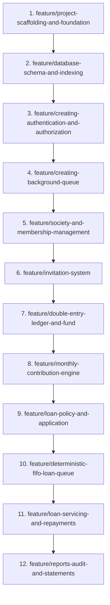

# Society Savings & Loan Management Platform
## Feature-by-Feature Implementation Plan

This implementation plan breaks the entire project down into **12 discrete, incremental features**. Each feature is designed to be developed, tested, and verified independently before moving to the next.

---

## Feature Roadmap Summary

---

## Detailed Feature Specifications

### 1. `feature/project-scaffolding-and-foundation`
* **Objective:** Establish the clean monorepo structure, backend virtual environment, and frontend Vite setup.
* **What we will build inside this feature:**
  - **Backend:**
    - Directory structure: `backend/app/`, `backend/tests/`.
    - `requirements.txt` with locked versions (FastAPI, SQLAlchemy, asyncpg, Pydantic v2, Uvicorn, Celery, Redis).
    - `backend/app/core/config.py`: Pydantic settings loading `.env`.
    - `backend/app/main.py`: FastAPI app initialization with CORS middleware and `GET /api/v1/health` endpoint.
  - **Frontend:**
    - Scaffold Vite + React 18 + TypeScript in `frontend/`.
    - Setup Tailwind CSS v3 with PostCSS and forms plugin.
    - Base layout with responsive shell, navigation placeholder, and Lucide icons.
  - **Configuration:** Root `.env.example`, `.gitignore`.
* **Done Criteria:** Running `uvicorn app.main:app --reload` returns `{"status": "ok"}` on port 8000; running `npm run dev` serves the React shell on port 5173.

---

### 2. `feature/database-schema-and-indexing`
* **Objective:** Create the consolidated, production-ready database schema and high-performance read-heavy indexes without incremental migration clutter.
* **What we will build inside this feature:**
  - `backend/app/db/schema.sql`:
    - Tables: `users`, `societies`, `society_memberships`, `roles`, `permissions`, `invitations`, `ledger_accounts`, `ledger_transactions`, `ledger_entries`, `contribution_policies`, `contribution_obligations`, `payments`, `loan_policies`, `loan_applications`, `loan_approvals`, `loan_reservations`, `loans`, `loan_installments`, `loan_repayments`, `audit_logs`, `notifications`.
    - All monetary amounts stored as `BIGINT` minor units (paise/cents).
  - High-performance read indexes:
    - Composite FIFO index: `idx_loan_apps_fifo_queue` on `(society_id, status, eligibility_at, fifo_sequence)`.
    - Arrears lookup index: `idx_obligations_society_status_due` on `(society_id, status, due_date)`.
    - Cashbook timeline index: `idx_ledger_tx_society_type_date` on `(society_id, transaction_type, effective_at DESC)`.
    - Multi-tenant lookup indexes: `idx_memberships_society_user` and `idx_memberships_society_status`.
  - `backend/app/db/seeds.sql`: Test data seeding demo society, committee roles, and test users.
  - `backend/app/db/init_db.py`: Script to connect to Supabase/PostgreSQL and apply `schema.sql` and `seeds.sql` in 1 command.
  - `backend/app/core/database.py`: SQLAlchemy async engine and session factory (`async_sessionmaker`).
  - `backend/app/models/`: SQLAlchemy 2.0 declarative models mapped 1:1 with the schema.
* **Done Criteria:** Running `python app/db/init_db.py` creates all tables and indexes in PostgreSQL and confirms connection health.

---

### 3. `feature/creating-authentication-and-authorization`
* **Objective:** Implement a pluggable authorization system featuring local dummy auth with a quick persona switcher, designed for future Google OAuth handoff.
* **What we will build inside this feature:**
  - **Backend:**
    - `backend/app/core/auth_provider.py`: Abstract `AuthProvider` interface.
    - `DummyAuthProvider`: Resolves mock user identity via `X-Dev-User` header or dev bearer token (`admin@platform.local`, `president@society.local`, `treasurer@society.local`, `secretary@society.local`, `member1@society.local`, `member2@society.local`).
    - `backend/app/api/deps.py`: `get_current_user` and `get_current_membership` FastAPI dependencies.
    - RBAC guard `require_society_role(roles: list[str])`.
    - `backend/app/api/v1/auth.py`: `/auth/me`, `/auth/dev-users`, `/auth/dev-login`.
  - **Frontend:**
    - `frontend/src/contexts/AuthContext.tsx`: Manages active user identity and auth headers.
    - `frontend/src/components/dev/DevUserSwitcher.tsx`: Floating UI widget at bottom-right allowing one-click switching between President, Treasurer, Secretary, and Members.
    - Axios interceptor automatically injecting active user identity into all API calls.
* **Done Criteria:** Switching personas in the floating UI changes the authenticated user in `/api/v1/auth/me` with zero page reloads or password prompts.

---

### 4. `feature/creating-background-queue`
* **Objective:** Configure the Celery distributed worker and Celery Beat scheduler with Redis as message broker.
* **What we will build inside this feature:**
  - `backend/app/tasks/celery_app.py`: Celery instance with Redis broker (`redis://localhost:6379/0`) and result backend (`redis://localhost:6379/1`).
  - Reliability configuration: `task_acks_late=True`, `task_reject_on_worker_lost=True`, `worker_prefetch_multiplier=1`.
  - Dedicated task queues: `fifo_allocation`, `billing_engine`, `notifications`.
  - `backend/app/tasks/test_tasks.py`: Ping/pong health task and celery heartbeat monitor.
  - Setup and startup scripts: `run_worker.bat` / PowerShell commands for running Celery worker and Celery Beat on Windows.
  - API endpoint: `POST /api/v1/dev/trigger-ping-task` to test async task roundtrip from FastAPI to Celery via Redis.
* **Done Criteria:** Firing the trigger endpoint enqueues a job into Redis, which is processed and logged by the Celery worker within 200ms.

---

### 5. `feature/society-and-membership-management`
* **Objective:** Enable society creation, multi-society memberships, and committee role assignment.
* **What we will build inside this feature:**
  - **Backend:**
    - `POST /api/v1/societies`: Create a society workspace (name, currency, timezone, financial year). Creator becomes founding admin/President.
    - `GET /api/v1/societies`: List all societies the current user belongs to.
    - `GET /api/v1/societies/{id}`: Detailed society profile.
    - `GET /api/v1/societies/{id}/members`: List all members and committee roles in that society.
    - `PATCH /api/v1/societies/{id}/members/{membership_id}/roles`: Assign/update roles (President, VP, Secretary, Treasurer, Member).
  - **Frontend:**
    - `frontend/src/contexts/SocietyContext.tsx`: Holds the currently active society workspace.
    - `frontend/src/components/common/SocietySwitcher.tsx`: Header dropdown allowing users to jump between their society memberships.
    - Create Society modal & Society Profile settings page.
    - Committee & Members table with search and role badges.
* **Done Criteria:** User can create "Greenwood Society", assign Treasurer role to User 2, and switch between societies using the top bar switcher.

---

### 6. `feature/invitation-system`
* **Objective:** Implement secure, invitation-only member registration with single-use cryptographic tokens.
* **What we will build inside this feature:**
  - **Backend:**
    - `POST /api/v1/societies/{id}/invitations`: Committee generates an invite link for an email/phone with an intended role and expiration date (stores SHA-256 token hash).
    - `GET /api/v1/invitations/{token}`: Inspect invitation details before accepting.
    - `POST /api/v1/invitations/{token}/accept`: Verifies token validity, marks token accepted, and binds the user to that society as an active member.
    - `POST /api/v1/societies/{id}/invitations/{invitation_id}/revoke`: Revokes a pending invitation.
  - **Frontend:**
    - Invite Member Modal for Committee officers with role selector.
    - Pending Invitations table showing status (Pending, Accepted, Expired).
    - Public / Authenticated Invitation Acceptance Page (`/invite/:token`).
* **Done Criteria:** Inviting `user@test.com` generates a token link; accepting it creates a membership; attempting to accept it a second time returns `400 Bad Request (Token already used)`.

---

### 7. `feature/double-entry-ledger-and-fund`
* **Objective:** Build the immutable double-entry ledger engine and dynamic fund balance calculation in minor units.
* **What we will build inside this feature:**
  - **Backend:**
    - Default Chart of Accounts generated per society:
      - Asset: `1010 Cash / Bank`, `1020 Loan Receivables`
      - Liability: `2010 Pending Loan Reserves`
      - Equity: `3010 Member Contributions`
      - Income: `4010 Loan Interest Income`, `4020 Late Fee Income`
    - `backend/app/services/ledger_service.py`:
      - Atomic transaction poster enforcing balanced entries ($\sum Debits = \sum Credits$).
      - Live dynamic balance calculations: Total Cash, Reserved Funds, Outstanding Principal, Available Loanable Cash.
    - `GET /api/v1/societies/{id}/fund/summary`: Real-time fund breakdown.
    - `GET /api/v1/societies/{id}/ledger`: Paginated cashbook and journal entries with account filters.
  - **Frontend:**
    - Society Fund Overview dashboard: Stat cards for Cash Balance, Reserved Funds, Outstanding Loans, and Available Loanable Cash.
    - Interactive Cashbook & Ledger table showing debit/credit entries, timestamps, and references.
* **Done Criteria:** Posting test debit and credit entries updates the fund balance dynamically; an unbalanced entry is automatically rejected with an integrity error.

---

### 8. `feature/monthly-contribution-engine`
* **Objective:** Automate monthly contribution billing and provide Treasurer payment recording with idempotency.
* **What we will build inside this feature:**
  - **Backend:**
    - Contribution policy endpoints: `POST /api/v1/societies/{id}/contribution-policies` (amount, due day, grace period).
    - Celery Beat scheduled task `tasks.generate_monthly_obligations`: Creates monthly dues on the 1st of every month for active members (protected by `UNIQUE(membership_id, period_start, period_end)`).
    - `POST /api/v1/societies/{id}/contributions/{obligation_id}/record-payment`: Treasurer records a confirmed cash/bank payment with receipt reference.
    - Automatically posts double-entry transaction (DEBIT Cash, CREDIT Member Contributions).
  - **Frontend:**
    - Member view: "My Contributions" showing current month's bill, due date, status badge (Due, Paid, Overdue), and payment receipt.
    - Treasurer view: Collection Register table with filter by month, member, and payment status, plus "Record Payment" modal.
* **Done Criteria:** Generating monthly obligations creates exactly one bill per member; recording payment moves status to `PAID` and credits the society cash ledger.

---

### 9. `feature/loan-policy-and-application`
* **Objective:** Allow societies to configure loan terms and allow eligible members to apply with a real-time EMI estimate.
* **What we will build inside this feature:**
  - **Backend:**
    - Loan policy endpoints: `POST /api/v1/societies/{id}/loan-policies` (annual/monthly interest rate, flat vs reducing balance, min/max loan limits, tenure).
    - `POST /api/v1/societies/{id}/loan-applications`: Member submits application (amount, tenure, purpose).
    - Real-time loan amortization preview helper calculating monthly installment, total interest, and total payable amount.
    - `POST /api/v1/societies/{id}/loan-applications/{id}/decision`: Committee decision endpoint (Approve, Reject, Request Info) with audit reason.
  - **Frontend:**
    - Apply for Loan modal with interactive EMI calculator updating as the user moves amount and tenure sliders.
    - Committee Loan Applications Review dashboard: View applicant details, credit history in the society, and approve/reject buttons.
* **Done Criteria:** Member submits loan request; committee officer approves it; application transitions to `APPROVED_WAITING_FUNDS`.

---

### 10. `feature/deterministic-fifo-loan-queue`
* **Objective:** Implement the concurrency-safe, deterministic First-In, First-Out loan queue allocation engine.
* **What we will build inside this feature:**
  - **Backend:**
    - Ordering logic: `ORDER BY eligibility_at ASC, fifo_sequence ASC`.
    - `backend/app/services/fifo_service.py`:
      - Uses `SELECT pg_advisory_xact_lock(:society_id)` to serialize allocation within each society.
      - Checks `available_loanable_cash`.
      - Strict all-or-nothing check: If `available_cash >= requested_amount`, reserves funds for 7 days (`loan_reservations`) and sets status to `RESERVED`. If insufficient, halts (no skipping ahead).
    - Celery task `tasks.fifo_allocation_sweep(society_id)` triggered automatically when funds enter the society.
    - Celery Beat hourly task `tasks.expire_stale_reservations` to release reservations un-disbursed after 7 days.
  - **Frontend:**
    - FIFO Queue Tracker: Visual numbered list of waiting members, showing timestamps, queue sequence, and reservation status.
    - Member dashboard widget: "Your Queue Position: #1 (Funds Reserved — Awaiting Disbursement)".
* **Done Criteria:** Two applications in queue (App 1 for ₹50k, App 2 for ₹20k). Cash is ₹30k. App 1 remains #1; App 2 is NOT skipped. Cash increases to ₹60k; App 1 is automatically reserved.

---

### 11. `feature/loan-servicing-and-repayments`
* **Objective:** Disburse approved reserved loans, generate installment schedules, and handle waterfall repayments.
* **What we will build inside this feature:**
  - **Backend:**
    - `POST /api/v1/societies/{id}/loans/{application_id}/disburse`: Disburses reserved loan, snapshots interest rate terms, generates `loan_installments` schedule, and posts ledger entries (DEBIT Loan Receivables, CREDIT Cash).
    - `POST /api/v1/societies/{id}/loans/{loan_id}/repayments`: Record borrower repayment.
    - Waterfall logic: Allocates funds to Fees -> Interest -> Principal.
    - Posts balanced double-entry transaction (DEBIT Cash, CREDIT Interest Income, CREDIT Loan Receivables).
    - Auto-closes loan when remaining principal is zero.
  - **Frontend:**
    - Active Loans Table: Outstanding principal, accrued interest, next installment due date.
    - Repayment Modal: Shows installment breakdown and records repayment.
    - Loan Detail view: Full amortization schedule table showing paid vs due installments.
* **Done Criteria:** Disbursing a loan reduces cash and increases loan receivables; making a repayment splits into interest income and principal reduction; completing all installments marks loan `CLOSED`.

---

### 12. `feature/reports-audit-and-statements`
* **Objective:** Deliver comprehensive transparency reports, immutable audit logs, and downloadable statements.
* **What we will build inside this feature:**
  - **Backend:**
    - Audit logging service: Automatically records actor, action, society, entity, and JSON `before_snapshot`/`after_snapshot`.
    - Reports endpoints:
      - `GET /api/v1/societies/{id}/reports/arrears`: Members with overdue contributions or loan installments.
      - `GET /api/v1/societies/{id}/reports/principal-outstanding`: Portfolio at risk and active lending summary.
      - `GET /api/v1/societies/{id}/loans/{loan_id}/statement`: Printable/downloadable loan statement.
  - **Frontend:**
    - Financial Reports tab: Arrears report, Collection summary, and Portfolio overview.
    - Audit Trail table: Filterable timeline of sensitive actions (approvals, role changes, disbursements) with diff viewer.
    - Member Statement view with export/print capability.
* **Done Criteria:** Every sensitive action produces a queryable audit record; member statements export clean, formatted transaction histories.

---

## Verification & Execution Approach

Each feature branch will follow a 3-step cycle:
1. **Implementation:** Code backend models, services, endpoints, and frontend components for that feature.
2. **Automated & Manual Verification:** Run automated tests for that feature and verify local UI behavior with the Dev Persona Switcher.
3. **Commit & Approval:** Clean git commit marking that feature complete before advancing to the next.
