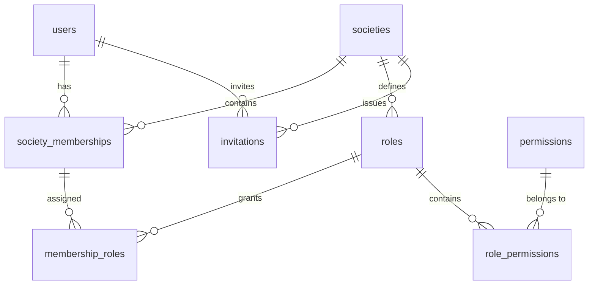

```text
->ledger account=>Systematic categorization of financial transactions to build financial statements (P&L, Balance Sheet).
```
# Society Savings & Loan Management Platform

A multi-tenant Software-as-a-Service (SaaS) web platform designed for community-based savings and lending groups (Chamas, Bishis, Chit Funds, SACCOs, and Mutual Aid Societies).

---

## Architecture Overview

- **Frontend:** React 18 + TypeScript + Vite + Tailwind CSS v3 + TanStack Query + Lucide Icons
- **Backend:** FastAPI (Python 3.12) + Pydantic v2 + SQLAlchemy 2.0 (asyncpg)
- **Database:** Supabase (PostgreSQL 15+) with consolidated schema & read-heavy indexes
- **Background Tasks:** Celery 5.4 + Redis 5.2 (FIFO allocation sweep, monthly obligations, overdue checks)
- **Auth:** Pluggable AuthProvider (Dummy Auth with Dev Persona Switcher in dev; Supabase Google OAuth in prod)

---

## Quickstart

### Prerequisites
- Python 3.12+
- Node.js 18+ and npm 10+
- Redis (for Celery background tasks)

### Backend Setup
```bash
# Navigate to backend directory
cd backend

# Create virtual environment (if not already created)
python -m venv .venv

# Activate virtual environment
# Windows:
.venv\Scripts\activate
# Linux/macOS:
# source .venv/bin/activate

# Install dependencies
pip install -r requirements.txt

# Run backend development server
uvicorn app.main:app --reload --port 8000
```
- API Docs: [http://localhost:8000/api/v1/docs](http://localhost:8000/api/v1/docs)
- Health Check: [http://localhost:8000/api/v1/health](http://localhost:8000/api/v1/health)

### Running Backend Tests
```bash
cd backend
.venv\Scripts\python.exe -m pytest
```

### Frontend Setup
```bash
# Navigate to frontend directory
cd frontend

# Install dependencies
npm install

# Run frontend development server
npm run dev
```
- App UI: [http://localhost:5173](http://localhost:5173)

---

## Project Structure
```
Society/
├── CONTEXT.md                       # Master architecture and non-negotiables guide
├── IMPLEMENTATION_PLAN.md           # 12-Feature step-by-step deliverable plan
├── backend/
│   ├── app/
│   │   ├── api/v1/                  # API endpoints and routers
│   │   ├── core/                    # Settings (config.py), auth provider, database
│   │   └── main.py                  # FastAPI application entry point
│   ├── tests/                       # Pytest test suite
│   ├── requirements.txt             # Locked Python dependencies
│   └── .env.example
├── frontend/
│   ├── src/
│   │   ├── components/common/       # Navbar, Sidebar, Layout
│   │   ├── services/api.ts          # Axios API client
│   │   ├── App.tsx                  # Dashboard & foundation shell
│   │   └── main.tsx                 # React DOM mount & providers
│   ├── package.json
│   ├── tailwind.config.js
│   └── vite.config.ts
└── Docs/                            # PRD and Technical specifications
```
