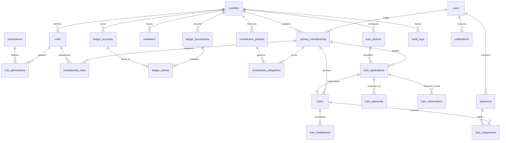
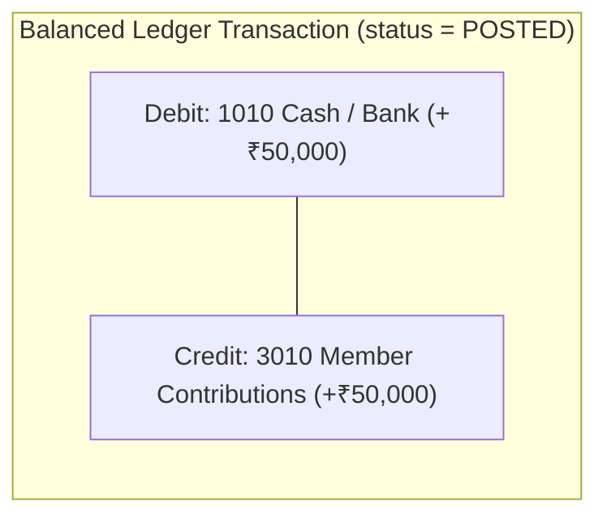
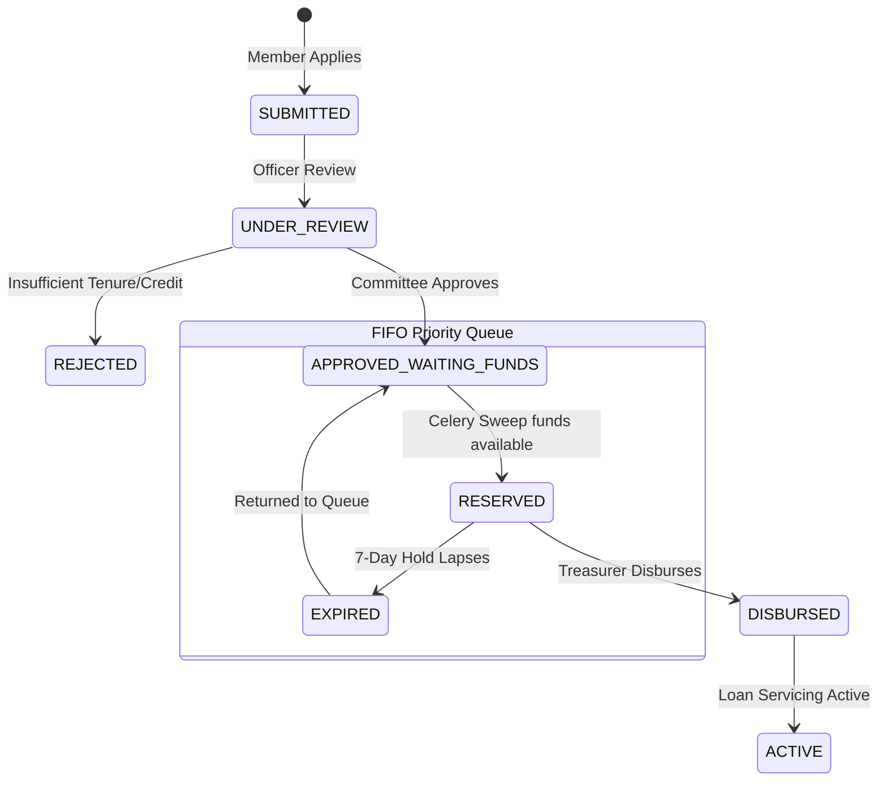

# Society Savings & Loan Management Platform
## Database Architecture, Schema Design & ORM Mapping Specification

---

## 1. Architectural Principles & Non-Negotiables

The database architecture is designed specifically for financial integrity, high-throughput read workloads, and multi-tenant SaaS safety.

> **The 5 Non-Negotiable Database Laws:**
> 1. **Monetary Datatype (`FLOAT`):**  
>    Monetary values are stored using standard floating-point precision (`FLOAT` / `DOUBLE PRECISION` in PostgreSQL, `sa.Float` in SQLAlchemy) across ledger accounts, contribution policies, and loan schedules.
> 2. **Double-Entry Ledger Invariance:**  
>    Balances are **never manually editable columns**. The society's loanable cash is dynamically computed from balanced, posted transactions ($\sum \text{Debits} = \sum \text{Credits}$).
> 3. **Strict Financial Separation:**  
>    SaaS platform subscription fees (`platform_subscriptions`) and community savings contributions (`contribution_obligations`) use completely separated account models and never cross paths.
> 4. **Deterministic FIFO Queue Indexing:**  
>    Active loan requests are sequenced strictly by approval time and a monotonic sequence number (`ORDER BY eligibility_at ASC, fifo_sequence ASC`) supported by a dedicated partial composite index.
> 5. **Alembic Database Migrations with SQLAlchemy:**  
>    The database schema is fully managed via **Alembic with declarative SQLAlchemy 2.0 models**. Raw SQL migration scripts are removed in favor of version-controlled Python migration files (`alembic upgrade head`) and pure SQLAlchemy seed routines.

---

## 2. Complete Entity-Relationship Model



---

## 3. Detailed Schema Breakdown (24 Entity Tables)

### Module A: Identity, Multi-Tenancy & RBAC

#### 1. `users`
Global platform identity. A user possesses a single platform account and can participate in multiple societies.
- **ORM Model:** `User` (`app/models/identity.py`)
- **Primary Key:** `id UUID DEFAULT gen_random_uuid()`
- **Key Columns:**
  - `email VARCHAR(255) UNIQUE`
  - `phone VARCHAR(50) UNIQUE`
  - `full_name VARCHAR(255) NOT NULL`
  - `password_hash VARCHAR(255)`
  - `account_status VARCHAR(50) NOT NULL DEFAULT 'ACTIVE'`
  - `email_verified_at TIMESTAMPTZ`, `phone_verified_at TIMESTAMPTZ`

#### 2. `societies`
Independent tenant workspace representing a community savings group (*Chama*, *Bishi*, or *Mutual Aid Society*).
- **ORM Model:** `Society` (`app/models/identity.py`)
- **Primary Key:** `id UUID DEFAULT gen_random_uuid()`
- **Key Columns:**
  - `legal_name VARCHAR(255) NOT NULL`, `display_name VARCHAR(255) NOT NULL`
  - `registration_number VARCHAR(100)`
  - `currency VARCHAR(10) NOT NULL DEFAULT 'INR'`
  - `timezone VARCHAR(50) NOT NULL DEFAULT 'Asia/Kolkata'`
  - `financial_year_start VARCHAR(10) NOT NULL DEFAULT '04-01'`
  - `status VARCHAR(50) NOT NULL DEFAULT 'ACTIVE'`

#### 3. `society_memberships`
Join entity binding global `users` to individual `societies`.
- **ORM Model:** `SocietyMembership` (`app/models/identity.py`)
- **Constraints:** `UNIQUE(society_id, user_id)` (prevents duplicate active memberships)
- **Key Columns:**
  - `society_id UUID NOT NULL REFERENCES societies(id) ON DELETE CASCADE`
  - `user_id UUID NOT NULL REFERENCES users(id) ON DELETE CASCADE`
  - `member_number VARCHAR(50)`
  - `status VARCHAR(50) NOT NULL DEFAULT 'ACTIVE'`
  - `joined_at TIMESTAMPTZ`, `left_at TIMESTAMPTZ`

#### 4. `roles` & `permissions`
Fine-grained Role-Based Access Control (RBAC).
- **ORM Models:** `Role`, `Permission` (`app/models/identity.py`)
- **System Roles:** `President`, `Vice President`, `Secretary`, `Treasurer`, `Member`
- **Granular Permissions:** `society:manage`, `member:invite`, `contribution:record`, `ledger:view`, `loan:approve`, `loan:disburse`, etc.

#### 5. `role_permissions` & `membership_roles`
Composite mapping tables for permission bundles and historical role assignments.
- **ORM Models:** `RolePermission`, `MembershipRole` (`app/models/identity.py`)
- **Key Columns:** `effective_from`, `effective_to` (supports time-bounded office tenures).

#### 6. `invitations`
Cryptographic single-use tokens for invitation-only member registration.
- **ORM Model:** `Invitation` (`app/models/identity.py`)
- **Key Columns:**
  - `token_hash VARCHAR(64) UNIQUE NOT NULL` (SHA-256 hash of the token, never raw)
  - `expires_at TIMESTAMPTZ NOT NULL`
  - `status VARCHAR(50) NOT NULL DEFAULT 'PENDING'` (`PENDING`, `ACCEPTED`, `REVOKED`, `EXPIRED`)

---

### Module B: Double-Entry Financial Ledger & Accounts



#### 7. `ledger_accounts`
Standard Chart of Accounts (COA) created automatically for each society tenant.
- **ORM Model:** `LedgerAccount` (`app/models/ledger.py`)
- **Constraints:** `UNIQUE(society_id, account_code)`
- **Standard Codes:**
  - `1010` - Cash / Bank Main Pool (`ASSET`)
  - `1020` - Loan Receivables (Principal) (`ASSET`)
  - `2010` - Pending Loan Reserves (`LIABILITY`)
  - `3010` - Member Contributions Capital (`EQUITY`)
  - `4010` - Loan Interest Income (`INCOME`)
  - `4020` - Late Fee & Penalty Income (`INCOME`)

#### 8. `ledger_transactions`
Auditable header records for financial transactions.
- **ORM Model:** `LedgerTransaction` (`app/models/ledger.py`)
- **Key Columns:**
  - `transaction_type VARCHAR(50)` (`CONTRIBUTION`, `DISBURSEMENT`, `REPAYMENT`, `ADJUSTMENT`)
  - `effective_at TIMESTAMPTZ` (accounting timeline)
  - `idempotency_key VARCHAR(100) UNIQUE`
  - `created_by`, `approved_by` (maker-checker separation of duties)

#### 9. `ledger_entries`
Immutable double-entry debits and credits.
- **ORM Model:** `LedgerEntry` (`app/models/ledger.py`)
- **Check Constraints:**
  - `chk_positive_amounts`: `debit_minor >= 0 AND credit_minor >= 0`
  - `chk_debit_or_credit`: Enforces that each entry is strictly either a debit or a credit, never both or neither.

---

### Module C: Contributions, Billing & Payments

#### 10. `contribution_policies`
Recurring savings terms configured by the society committee.
- **ORM Model:** `ContributionPolicy` (`app/models/contribution.py`)
- **Key Columns:** `amount_minor BIGINT`, `due_day INT`, `grace_period_days INT`, `late_fee_minor BIGINT`.

#### 11. `contribution_obligations`
Individual periodic billing dues generated by Celery Beat on the 1st of every month.
- **ORM Model:** `ContributionObligation` (`app/models/contribution.py`)
- **Constraints:** `UNIQUE(membership_id, period_start, period_end)` (idempotent billing guarantee).
- **Statuses:** `DUE`, `PAID`, `PARTIAL`, `OVERDUE`, `WAIVED`.

#### 12. `payments`
Recorded monetary receipts from manual cash entries or payment gateway integrations.
- **ORM Model:** `Payment` (`app/models/contribution.py`)
- **Key Columns:** `payment_scope`, `provider`, `provider_transaction_id`, `idempotency_key`.

#### 13. `platform_subscriptions`
Platform operator recurring SaaS subscription records, isolated from society ledger pools.
- **ORM Model:** `PlatformSubscription` (`app/models/contribution.py`)

---

### Module D: Loan Policy, Applications & Deterministic FIFO Queue



#### 14. `loan_policies`
Lending guidelines configured per society.
- **ORM Model:** `LoanPolicy` (`app/models/loan.py`)
- **Key Columns:**
  - `interest_rate NUMERIC(6, 4)` (e.g. `0.0800` for 8%)
  - `interest_period` (`ANNUAL`, `MONTHLY`)
  - `interest_method` (`REDUCING_BALANCE`, `FLAT`)
  - `calculation_convention` (`MONTHLY_AMORTIZATION`)
  - `min_amount_minor`, `max_amount_minor`, `min_tenure_months`, `max_tenure_months`
  - `allocation_rule` (`STRICT_FIFO`)

#### 15. `loan_applications`
Member loan requests with immutable queue ordering timestamps.
- **ORM Model:** `LoanApplication` (`app/models/loan.py`)
- **Queue Ordering:** `ORDER BY eligibility_at ASC, fifo_sequence ASC`.
- **Statuses:** `SUBMITTED`, `UNDER_REVIEW`, `APPROVED_WAITING_FUNDS`, `RESERVED`, `DISBURSED`, `REJECTED`, `CANCELLED`.

#### 16. `loan_approvals`
Audit-trailed approval decisions by authorized committee officers.
- **ORM Model:** `LoanApproval` (`app/models/loan.py`)

#### 17. `loan_reservations`
7-day temporary fund holds allocated by the Celery FIFO sweep under PostgreSQL transaction advisory lock.
- **ORM Model:** `LoanReservation` (`app/models/loan.py`)

---

### Module E: Loan Servicing, Installments & Waterfall Repayments

#### 18. `loans`
Active loan contracts generated upon disbursement.
- **ORM Model:** `Loan` (`app/models/loan.py`)
- **Term Snapshots:** Snapshots `interest_rate_snapshot`, `interest_method_snapshot`, and `calculation_convention_snapshot` so future policy changes never alter active loan terms.

#### 19. `loan_installments`
Pre-calculated loan amortization schedule.
- **ORM Model:** `LoanInstallment` (`app/models/loan.py`)
- **Constraints:** `UNIQUE(loan_id, installment_number)`
- **Key Columns:** `principal_due_minor`, `interest_due_minor`, `fees_due_minor`, `status`.

#### 20. `loan_repayments`
Repayment records executed under the strict waterfall repayment model:
$$\text{Payment} \longrightarrow \text{Late Fees} \longrightarrow \text{Accrued Interest} \longrightarrow \text{Principal Reduction}$$
- **ORM Model:** `LoanRepayment` (`app/models/loan.py`)

---

### Module F: Audit Trail & Communications

#### 21. `audit_logs`
Immutable before-and-after audit logs for all sensitive financial and committee actions.
- **ORM Model:** `AuditLog` (`app/models/audit.py`)
- **Key Columns:** `actor_user_id`, `action`, `entity_type`, `entity_id`, `before_snapshot JSONB`, `after_snapshot JSONB`.

#### 22. `notifications`
In-app and async communication events.
- **ORM Model:** `Notification` (`app/models/audit.py`)

---

## 4. High-Performance Read-Heavy Indexing Strategy

To maintain sub-2ms query times on large societies, 11 dedicated composite B-Tree indexes are deployed:

| Index Name | Target Table | Indexed Columns | Justification / Query Pattern |
|---|---|---|---|
| `idx_memberships_society_user` | `society_memberships` | `(society_id, user_id)` | Authenticated API tenant authorization check executed on every HTTP request. |
| `idx_memberships_society_status` | `society_memberships` | `(society_id, status)` | Fast active member count and directory queries. |
| `idx_loan_apps_fifo_queue` | `loan_applications` | `(society_id, status, eligibility_at, fifo_sequence)` | **Partial Index (`WHERE status = 'APPROVED_WAITING_FUNDS'`):** Powers the Celery FIFO allocation worker with index-only scans. |
| `idx_obligations_society_status_due` | `contribution_obligations` | `(society_id, status, due_date)` | Daily Celery sweep for overdue dues and Treasurer collection register. |
| `idx_obligations_member_period` | `contribution_obligations` | `(membership_id, period_start, period_end)` | Member "My Contributions" dashboard and duplicate obligation prevention. |
| `idx_ledger_tx_society_type_date` | `ledger_transactions` | `(society_id, transaction_type, effective_at DESC)` | Chronological cashbook timeline and financial register retrieval. |
| `idx_ledger_entries_tx_acc` | `ledger_entries` | `(transaction_id, account_id)` | Fast balance aggregations per ledger account. |
| `idx_loans_society_status` | `loans` | `(society_id, status)` | Portfolio at risk and active lending summaries. |
| `idx_installments_loan_status_due` | `loan_installments` | `(loan_id, status, due_date)` | Upcoming installment and default monitoring. |
| `idx_audit_society_created` | `audit_logs` | `(society_id, created_at DESC)` | Filterable society audit trail. |
| `idx_notifications_user_status` | `notifications` | `(user_id, status, created_at DESC)` | In-app notification bell and unread count stream. |

---

## 5. SQLAlchemy 2.0 ORM Mapping Architecture

The Python application maps 1:1 with PostgreSQL using modern SQLAlchemy 2.0 typing:

```python
class LedgerEntry(Base, UUIDPrimaryKeyMixin):
    __tablename__ = "ledger_entries"
    __table_args__ = (
        Index("idx_ledger_entries_tx_acc", "transaction_id", "account_id"),
    )

    transaction_id: Mapped[uuid.UUID] = mapped_column(
        UUID(as_uuid=True), 
        ForeignKey("ledger_transactions.id", ondelete="CASCADE"), 
        nullable=False
    )
    account_id: Mapped[uuid.UUID] = mapped_column(
        UUID(as_uuid=True), 
        ForeignKey("ledger_accounts.id", ondelete="RESTRICT"), 
        nullable=False
    )
    debit: Mapped[float] = mapped_column(Float, default=0.0, nullable=False)
    credit: Mapped[float] = mapped_column(Float, default=0.0, nullable=False)
    currency: Mapped[str] = mapped_column(String(10), default="INR", nullable=False)

    transaction: Mapped["LedgerTransaction"] = relationship("LedgerTransaction", back_populates="entries")
    account: Mapped["LedgerAccount"] = relationship("LedgerAccount", back_populates="entries")
```

### Connection Pool & Resilience Configuration
Configured in `backend/app/core/database.py`:
- **Driver:** `asyncpg` via `create_async_engine`.
- **Pool Size:** `20` concurrent connections, with `10` max overflow.
- **Statement Cache:** `statement_cache_size=0` (critical for Supabase Supavisor connection pooler to prevent prepared statement collisions).
- **Pool Pre-Ping:** `pool_pre_ping=True` (proactively tests stale connections before handing to session).
- **Auto-Rollback Session Lifecycle:** `get_db` automatically rolls back on exceptions and closes sessions cleanly.
- **Exponential Back-Off:** Integrated with `backend/app/core/retry.py` with full randomized jitter for transient network drops.

---

## 6. Alembic Migrations & Automated Bootstrapping

Database migrations and initial environment seeding are executed without raw SQL files:

### A. Running Migrations via Alembic CLI
```bash
# Apply all pending migrations to head
alembic upgrade head

# Generate a new autogenerated migration after editing models
alembic revision --autogenerate -m "describe_changes"

# Check current revision status
alembic current
```

### B. Programmatic Bootstrapper & Verification (`init_db.py`)
```bash
python backend/app/db/init_db.py
```
- Programmatically executes `alembic upgrade head` via the Alembic Python API.
- Runs `seed_data.py` to populate permissions, roles, Greenwood Society, Chart of Accounts, and development personas using pure SQLAlchemy ORM `insert().on_conflict_do_nothing()`.
- Automatically queries PostgreSQL `information_schema` and `pg_indexes` to verify all **24 tables** and **11 composite indexes**.
